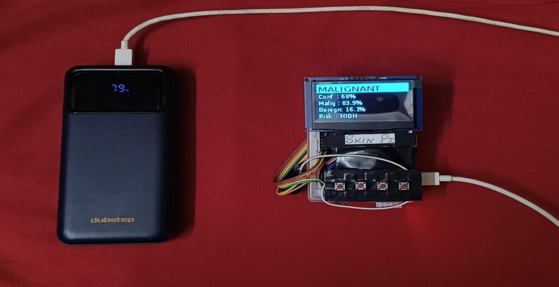
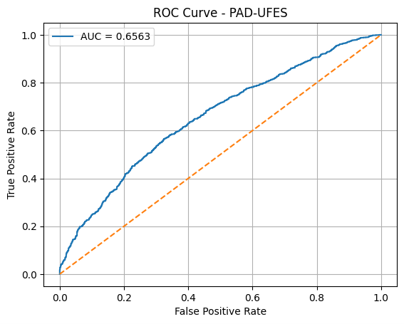
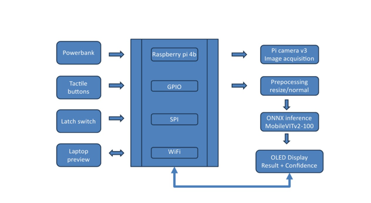
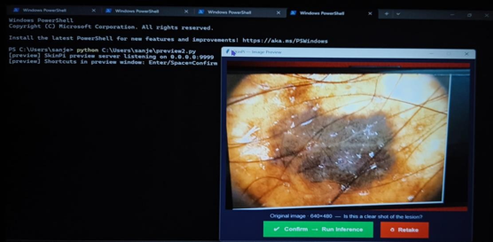
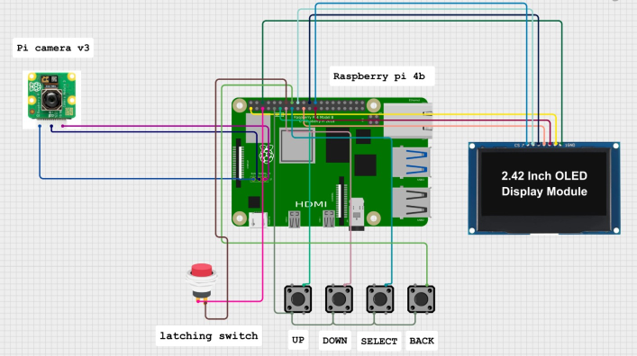

# SkinPi: Offline Edge Skin Lesion Classifier (Raspberry Pi 4B)

A fully offline, battery-powered device that classifies dermoscopic skin lesion images as malignant or benign on a Raspberry Pi 4B, using a compact hybrid CNN-Transformer (MobileViTv2-100, 4.3M parameters). It needs no GPU and no internet connection at inference time.

> **Disclaimer:** SkinPi is an academic research prototype. It is not a medical device, has not been clinically validated, and must not be used for diagnosis or treatment decisions.



## Highlights

- MobileViTv2-100 (4.3M parameters), fine-tuned for binary malignant/benign classification
- Trained on BCN20000; evaluated on HAM10000, PH2 and PAD-UFES-20
- Exported to ONNX and run with ONNX Runtime on aarch64 Linux: about 2-4 s per image on the Pi 4B CPU
- Full hardware-software system: Pi Camera Module V3, 2.42-inch SSD1309 OLED, button-driven menu, laptop preview over TCP socket, systemd auto-start

## Results

Model trained on BCN20000 only. Decision threshold 0.64 (Youden's index on the BCN20000 validation split).

| Dataset | Images | Sensitivity | Specificity | AUC-ROC | Role |
|---|---|---|---|---|---|
| BCN20000 (validation split) | 2,047 | 88.09% | 81.83% | 0.9281 | Validation (threshold tuned here) |
| HAM10000 | 10,015 | 77.38% | 72.31% | 0.8318 | Development set (used for checkpoint selection) |
| PH2 | 200 | 92.50% | 67.50% | 0.9064 | External test |
| PAD-UFES-20 | 2,298 | 75.39% | 44.00% | 0.6563 | External test |

Raw outputs are in [`results/`](results/): `results_summary.md`, `ph2_results.txt` and `pad_ufes20_results.txt`.

ROC curve on PAD-UFES-20:



### Evaluation protocol

- **HAM10000 influenced checkpoint selection.** Its sensitivity was monitored every epoch and used to pick the saved checkpoint (epoch 53 of 100). The model was never trained on HAM10000 images, but the HAM10000 numbers are optimistic and should be read as a development set, not an independent test.
- **PH2 and PAD-UFES-20 are the unbiased external evaluations.** Each was evaluated once with the final checkpoint and the fixed threshold of 0.64. No selection or tuning was done on them. ("Run 7" in the PH2 output header is the Kaggle notebook version number.)

### Notes on the external sets

- **PH2** (200 dermoscopic images: 40 melanoma, 80 atypical nevi, 80 common nevi): 37 of 40 melanomas were detected, but precision is only 41.6% (52 false positives), and atypical nevi are classified correctly only 60.0% of the time. With 40 positives, the confidence interval on sensitivity is wide.
- **PAD-UFES-20** (2,298 smartphone clinical photographs, not dermoscopy): performance drops sharply (AUC 0.656, specificity 44.0%, precision 54.8%). About 47% of the images are malignant (1,089 of 2,298), which differs from the training distribution, so precision and accuracy here are not comparable with the dermoscopic sets.

## System Overview



1. The Pi Camera Module V3 captures the lesion image.
2. Optionally, the image is sent over a TCP socket to a laptop for preview before confirming.
3. The ONNX model runs on the Pi CPU through ONNX Runtime.
4. The result (label, malignant and benign probability, confidence and risk tier) appears on the OLED, navigated with tactile buttons.
5. The Pi creates its own WiFi hotspot, so the device works with no existing network.

Laptop preview window (operator confirms or retakes the captured image):



## Hardware

- Raspberry Pi 4B and Raspberry Pi Camera Module V3
- 2.42-inch SSD1309 OLED display (SPI), driven with luma.oled
- Four tactile buttons (Up / Down / Select / Back) and a latching power button for safe shutdown
- Power bank

| Component | Signal | Physical pin | BCM GPIO |
|---|---|---|---|
| OLED | VCC (3.3V) | 1 | - |
| OLED | GND | 6 | - |
| OLED | CLK (SPI clock) | 23 | GPIO 11 |
| OLED | MOSI (SPI data) | 19 | GPIO 10 |
| OLED | RST (reset) | 22 | GPIO 25 |
| OLED | DC (data/command) | 18 | GPIO 24 |
| OLED | CS (chip select) | 24 | GPIO 8 |
| Button UP | Input | 11 | GPIO 17 |
| Button DOWN | Input | 13 | GPIO 27 |
| Button SELECT | Input | 15 | GPIO 22 |
| Button BACK | Input | 16 | GPIO 23 |
| Latching switch | Shutdown input | 5 | GPIO 3 |
| Latching switch | GND reference | 14 | - |
| Pi Camera V3 | CSI interface | CSI ribbon port | - |
| Power bank | Power input | USB-C port | - |

Wiring diagram (illustrative; the table above is the reference for exact pins):



## Model and Training

- **Architecture:** MobileViTv2-100 (timm), 4.3M parameters.
- **Data:** BCN20000 cleaned into a binary set, 11,599 training and 2,047 validation images (stratified random split).
- **Techniques:** focal loss, three-phase progressive unfreezing, discriminative learning rates, cyclic cosine learning-rate schedule with restarts, MixUp, stochastic weight averaging, test-time augmentation.
- **Threshold:** chosen on the validation split with Youden's index.
- **Deployment:** exported to ONNX and run with ONNX Runtime. A TFLite INT8 conversion was attempted and abandoned because of an unsupported operation mismatch.

## Repository Structure

```
SkinPi/
├── training/train_mobilevitv2.py
├── validation/validate_ph2.py
├── validation/validate_pad_ufes20.py
├── results/        # results summary, raw outputs, ROC curve
├── docs/           # device photo, block diagram, wiring diagram, preview screenshot
├── requirements.txt
├── .gitignore
└── LICENSE
```

The scripts were originally run on Kaggle, so dataset and model paths (`/kaggle/input/...`) must be adjusted to run them locally. Install the dependencies with `pip install -r requirements.txt`.

## Datasets

Datasets are not included. Download them from their official sources and check each license.

- BCN20000: Combalia et al., "BCN20000: Dermoscopic Lesions in the Wild" (2019). Search for the official release (ISIC archive / Hospital Clinic de Barcelona).
- HAM10000: Tschandl, Rosendahl and Kittler, "The HAM10000 dataset, a large collection of multi-source dermatoscopic images of common pigmented skin lesions", Scientific Data, 2018. Search for the official release (Harvard Dataverse / ISIC archive).
- PH2: Mendonça et al., "PH2 - A dermoscopic image database for research and benchmarking", EMBC 2013. [Official source](https://www.fc.up.pt/addi/ph2%20database.html) (registration required).
- PAD-UFES-20: Pacheco et al., "PAD-UFES-20: A skin lesion dataset composed of patient data and clinical images collected from smartphones", Data in Brief, 2020 (CC BY 4.0). [Official source](https://data.mendeley.com/datasets/zr7vgbcyr2/1).

## Limitations

- Research prototype with no clinical validation or prospective study.
- Binary classification only (malignant vs benign); it does not identify lesion types.
- HAM10000 was used during checkpoint selection, so its numbers are optimistic.
- Specificity is modest: on PH2 precision is 41.6% (52 false positives), and on PAD-UFES-20 specificity is only 44.0%.
- Performance drops sharply on non-dermoscopic images (PAD-UFES-20).
- The BCN20000 train/validation split is a random image-level split, not grouped by lesion or patient, so validation scores may be somewhat optimistic.
- The datasets under-represent darker skin tones.
- The Raspberry Pi deployment code (capture, inference, OLED UI, socket server) lives on the device submitted to my college and is not included in this repository.

## Future Work

- Group splits by lesion or patient and select checkpoints on validation data only
- Evaluate on larger and more diverse external datasets
- Improve calibration and specificity
- Add multi-class lesion classification

## Author

M. Sanjeevi Raj, B.E. Biomedical Engineering, Sree Sastha Institute of Engineering and Technology, Chennai

[LinkedIn](https://www.linkedin.com/in/sanjeevi-raj001) | sanjeeviraj2018@gmail.com

## License

MIT License (see the LICENSE file). The datasets have their own licenses and are not covered by this one.